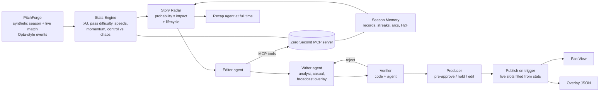

# Zero Second

**The anticipation layer for football. Ready before it happens.**

Most AI football tools explain a moment *after* it happens. Zero Second forecasts the storylines that **could** happen next, has AI agents prepare verified content for them **in advance**, lets a producer **pre-approve** it, and publishes the instant the moment happens. Every prediction is tracked to its outcome: *Happened*, *Near miss*, *Ruled out* or *Unresolved*.

**Live demo:** [Media Desk](https://zero-second.kindwave-e64411c5.eastus2.azurecontainerapps.io/desk) (producers) · [Fan View](https://zero-second.kindwave-e64411c5.eastus2.azurecontainerapps.io/fan) (best on a phone). No login needed; add `?room=yourname` for your own match.

**Demo video (1:55):** https://youtu.be/mxpBGSXXRhA

Built for the Microsoft × Premier League **Inside the Game** hackathon, challenge *The Synthetic Match Insights Engine for Premier League Studio*. Target category: **Best Enterprise Solution**.

| | |
|---|---|
| Media Desk (producers) | `/desk` – live rundown, Story Radar, pre-approval, overlay preview, agent trace, audit log, recap |
| Fan View (mobile web) | `/fan` – moments, "Watch for" forecasts, Casual / Analyst, follow a player, favourite club, metric focus |
| MCP server | `/mcp/` – Stats Engine and Season Memory as tools for any agent |
| Overlay feed | `/api/rooms/{room}/overlays.json` – timed, machine-readable lower-thirds |

All data is synthetic: invented clubs, players and seasons.

---

## Why it matters

Club and broadcaster media teams already prepare graphics for likely moments **by hand**, for a few obvious cases. Leagues use AI that **reacts** (live tickers, automated insights). Nobody ships the step in between: a system that continuously works out what *could* happen, prepares and verifies it, and gets human sign-off **before** the moment, so publishing is instant and safe.

For fans, the forecast itself is content: a ranked **Watch for** list ("Harbour City late winner? 24%") with the reason it is rising and why it would matter.

## How it works



1. **PitchForge** generates a seeded season and a live match (passes, pressures, tackles, interceptions, shots, cards, subs, sprints, physical data, match metadata) in an Opta-style format, so a real feed could replace it. Outcomes come from *hidden* player traits that nothing downstream can see.
2. **Stats Engine** (code, no AI): its own xG model, pass difficulty (0–10), ball and shot speed, sprint and distance player tags, momentum, control-vs-chaos index, pressure spikes.
3. **Season Memory**: last season, this season, player arcs (dropped, returned, signed), milestones, clean-sheet streaks, late winners, head-to-head. Every fact has an id agents must cite.
4. **Story Radar** ranks storylines by *probability × impact* using a documented, calibrated model (below) and moves each one through **Rising → Writing → Ready → Pre-approved → Happened / Near miss / Ruled out / Unresolved**.
5. **Agents** (Microsoft Agent Framework on Microsoft Foundry):
   - **Editor** picks the angle, querying the MCP server for context.
   - **Writer** pre-writes four versions with *live slots* (`{minute}`, `{shot_xg}`, `{score}`) that code fills at the moment.
   - **Verifier** checks every number and player name against the facts pack (code), then meaning (agent). Rejections go back to the Writer, up to two redrafts, then a deterministic fallback.
   - **Recap** writes broadcaster, casual and analyst recaps from the lifecycle log, with citations.
6. **Producer** pre-approves, holds, edits (re-verified) or revokes. Everything is in the **audit log** and **Agent Trace**.

Each storyline card answers four questions: **what could happen**, **how likely** (model), **why it's rising** (stats), **why it would matter** (Season Memory).

## The probability model (not LLM-guessed)

```
team rate  λ = scale · ((1 − w)·prior + w·recent) · score-effect
prior        = Season Memory scoring/conceding rates, shrunk to the league mean
recent       = team xG over the last 15 minutes
player       P = 1 − exp(−λ · share · minutes_left)
clean sheet  P = exp(−λ_opp · minutes_left)
win / late winner: exact Poisson enumeration of the remaining goals
```

`scale`, `recent_weight`, `prior_games` and `state_boost` are **fitted on 60 training matches and evaluated on 200 different held-out matches** (`python -m zerosecond.calibration --fit 60`). Current result: Brier **0.0628** vs **0.0852** for a base-rate baseline (**26% skill**, 4,309 forecasts). Player storylines are well calibrated (brace: predicted 7.0%, actual 6.8%). Team results above 60% are still somewhat over-confident (small samples); see [docs/MODEL.md](docs/MODEL.md).

## Enterprise controls

- Human approval before anything is published; hold, edit and revoke; autopilot mode is explicit and labelled.
- Numbers come from code; the Verifier rejects any number or player not in the facts pack, including after a producer edit and after live slots are filled.
- **Fault injection** toggle (chaos test) corrupts a draft so you can watch the Verifier catch it and the Writer redraft.
- Agent timeouts and model errors fall back to a deterministic writer; one failing storyline never stops the match.
- Full audit log and per-storyline Agent Trace (lanes, timings, tool calls, rejected drafts).
- No keys in the app: managed identity to Foundry on Azure Container Apps.

## Microsoft technology

| | Used for |
|---|---|
| **Microsoft Foundry** | Hosts gpt-5-mini behind the Editor, Writer, Verifier and Recap agents (`FoundryChatClient`, low reasoning effort) |
| **Microsoft Agent Framework** (Python 1.23) | Agent definitions, tool calling, MCP client (`MCPStreamableHTTPTool`) |
| **Model Context Protocol** | Zero Second MCP server exposes Stats Engine and Season Memory tools |
| **Azure Container Apps** | Runs the single container (web, API, SSE stream, MCP, agents) |
| **Azure Container Registry** | Image build via `az containerapp up` |
| **Managed identity + Azure RBAC** | Keyless access to Foundry |
| **GitHub** | Public repository and CI |

## Run it locally

Requirements: Python 3.12+ and Node 20+.

```bash
cd backend
python -m venv .venv
.venv/Scripts/pip install -r requirements-dev.txt     # macOS/Linux: .venv/bin/pip
.venv/Scripts/python -m uvicorn zerosecond.api:app --port 8000
```

```bash
cd frontend
npm install
npm run dev        # http://localhost:5173/desk  (proxies /api to :8000)
```

Or build the web app once (`npm run build`) and open http://localhost:8000/desk.

Without Foundry settings the agents use the deterministic local writer, so everything works offline. To use Foundry, copy `backend/.env.example` to `backend/.env`, fill in `FOUNDRY_PROJECT_ENDPOINT` and `FOUNDRY_MODEL`, and run `az login`.

Tests: `cd backend && .venv/Scripts/python -m pytest -q`

## Try the demo

1. Open **/desk**. Press **Play** (20×), or use **Jump** (60', 66', 72', 77', 80', FT).
2. Watch *Mendes – 50th club goal* rise as Harbour City's xG surges after 63'. Turn **Autopilot producer** off to pre-approve it yourself (press **A**).
3. At 78' it happens: the content publishes instantly with the real xG and shot speed filled in. Open **/fan** to see the fan's version (try Casual and Analyst).
4. Turn on **Fault injection**, jump ahead, and open **Agent Trace** to see the Verifier reject and the Writer redraft.
5. At full time open **Recap**: storyline outcomes, the agent-written recaps with citations, and forecast calibration.
6. **New match → Random seed** (or type a seed such as `4821`) runs a fully random match in the same world. Nothing is scripted except the demo match's goals, post and one substitution; every probability is computed live.

Each `?room=<name>` is an independent match, so several people can test at once.

## Repository

```
backend/zerosecond/
  pitchforge/   world, season, live match simulator, demo scenario
  stats/        Stats Engine (xG, pass difficulty, momentum, tags)
  memory/       Season Memory
  radar/        probability model + Story Radar lifecycle
  agents/       orchestrator, Foundry agents, local writer, verifier, facts packs
  mcp_server.py MCP tools     api.py  FastAPI + SSE     runtime.py  match rooms
  calibration.py  fit + held-out evaluation
frontend/src/   React app: Media Desk, Agent Trace, Recap, Season Memory, Fan View
infra/          Azure Container Apps deployment
docs/           architecture, model card, deployment, video script, submission text
```

## License

MIT. Synthetic data only; no real clubs, players, logos or match footage.
