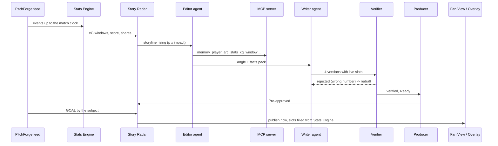

# Architecture

One container (FastAPI + React build) runs everything; each match room is independent.

## Components
| Module | Responsibility | AI? |
|---|---|---|
| `pitchforge/` | Seeded world, season history, live match simulator, demo scenario | No |
| `stats/` | Event-driven metrics, insights (pressure spikes, player tags) | No |
| `memory/` | Season Memory queries with fact ids | No |
| `radar/model.py` | Probability model (fitted, documented) | No |
| `radar/radar.py` | Storyline templates, activation, triggers, lifecycle | No |
| `agents/orchestrator.py` | Pipeline, shared state, approvals, publishing, audit, traces | Orchestrates |
| `agents/foundry.py` | Editor, Writer, Verifier, Recap on Microsoft Foundry via Agent Framework | Yes |
| `agents/local_writer.py` | Deterministic fallback writer | No |
| `agents/verifier.py` | Numeric and name verification against facts packs | No |
| `mcp_server.py` | MCP tools over Stats Engine, Season Memory and Story Radar | No |
| `runtime.py` | Match clock, rooms, snapshots | No |
| `api.py` | REST, SSE stream, `/mcp`, static web app | No |

## Shared state and handoffs
The orchestrator owns a `Content` record per storyline (facts pack, versions, rejected drafts, state, approvals). Agents only receive the facts pack and return drafts; state changes are made by code and written to the audit log. Story Radar owns the lifecycle; the orchestrator sets the preparation states (Writing, Ready, Pre-approved).

## Failure handling
| Failure | Behaviour |
|---|---|
| Writer draft has an unsupported number or player | Verifier rejects, Writer redrafts with the issues (max 2), then deterministic fallback |
| Model error or timeout (`ZS_AGENT_TIMEOUT`) | Logged, deterministic writer used for that step |
| MCP unavailable | Editor runs without tools; facts pack still built by code |
| Storyline triggers while still being written | Reactive path writes and verifies on the spot, labelled "reactive" |
| Goal with no storyline | Reactive goal moment |
| Producer edit | Re-verified before saving |
| Slot fill produces an unsupported value | Held for manual approval |

## Data formats
- Events: `{id, matchId, period, t, minute, second, type, team, player, x, y, endX, endY, outcome, qualifiers}` with Opta-style 0–100 coordinates in the attacking direction.
- Overlay cue: `{id, type: "lower_third", storyline, trigger: {event, matchClock}, in, out, headline, sub, player, team}` at `/api/rooms/{room}/overlays.json`.
